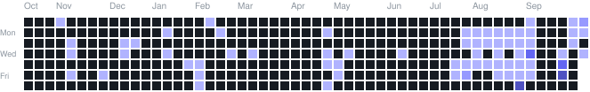

  

 

  
  
  

---

## 👋 About Me

- 🎓 Studying **Computer Technology & Information Systems (CTIS)** at **Trakya University**
- 💻 I build **web applications**, **desktop tools** and **AI-powered side projects**
- 🌱 Currently exploring **AI integrations**, **browser extensions** and **developer tooling**
- 📫 Reach me at **erenbatialtunkapak@gmail.com**

---

## 🛠️ Tech Stack

**Languages**

 

**Frameworks & Libraries**

 

**AI & Data**

 

**Tools**

---

